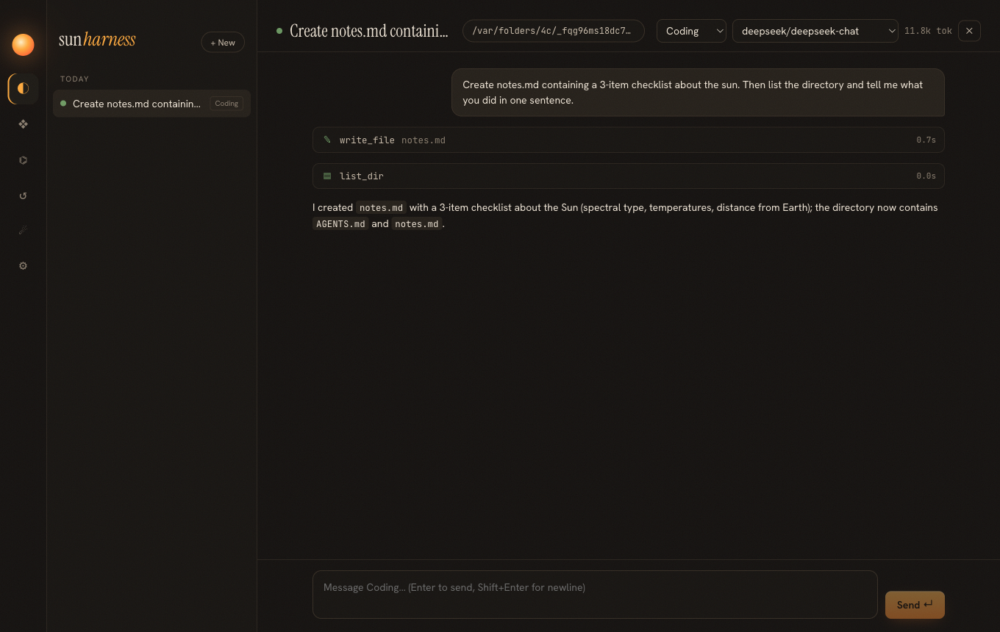

# sun-harness

A personal, first-principles agent harness: a **coding agent**, a **general task agent** (Manus-like), and a **personal assistant** (Hermes-like) in one desktop app and CLI. It grows with you and with the field: it reads your rules and knowledge, survives quota exhaustion, watches other harnesses daily, and proposes its own improvements.



## Why

A harness reduces to six parts: **model, context, tools, loop, log, policy**. sun-harness implements those six small and durable, and everything else (desktop UI, skills, MCP, plugins, knowledge, intel, evolution) as extensions of them. See [`specs/000-vision.md`](specs/000-vision.md) and the [teaching pages](docs/teach/index.html).

## Features

- **Desktop app** (Electron + React): streaming sessions, tool cards, approval cards, plan view, paused banner with resume / switch-model, knowledge, extensions, evolution, intel and settings screens.
- **CLI** `sun`: interactive chat, one-shot `run` with exit codes, `resume`, `init`, `intel`, `kb`, `evolve`, `doctor`.
- **Any model**: DeepSeek, OpenAI, Anthropic, GLM, Qwen, Gemini, OpenRouter, Ollama (OpenAI-compatible and Anthropic wire formats), switchable per session.
- **Durable by design**: every session is an append-only JSONL log; quota or auth failures pause the run, fallback models take over, and resume continues exactly where it stopped.
- **Anti-drift context**: AGENTS.md hierarchy, CLAUDE.md, `.sun/rules`, `.cursor/rules`, and a specs index in every request; `sun init` scaffolds them.
- **Extensions**: Claude-compatible skills, MCP (stdio / HTTP / SSE), ESM plugins, shell hooks with fail-closed option.
- **Knowledge**: personal Markdown KB with BM25 (CJK-aware), memory file, reserved company-KB HTTP provider.
- **Modes**: coding, agent, assistant; subagents; scheduled tasks.
- **Harness intel**: daily fetch of 14 harness release feeds, LLM analysis of what changed and why it works, launchd schedule.
- **Evolution**: reflection and intel produce proposals (memory, skill, rule, feature) that you accept or reject.
- **Gateway + web UI**: `sun serve` owns every session (schedules, jobs, auto-resume run headless); CLI, desktop and browser attach as clients.
- **Worktree sessions**: parallel coding on isolated branches; review the diff, squash-merge or discard.
- **Background jobs**: long commands and slow MCP calls run in the background; results come back into the session.
- **Context budgets**: per-model context windows, separate rule budgets, safe compaction when switching to a smaller model.
- **Hybrid knowledge (optional)**: BM25 + embeddings with rank fusion; finds notes across languages.
- **Packaged macOS app**: `pnpm desktop:install` → `~/Applications/sun-harness.app`.
- **Remote access**: `sun serve --tls`, per-device tokens, certificate-pinned `sun remote` clients.
- **Chat bots**: Telegram, DingTalk, Feishu, WeChat Official Account, WeCom and webhook bots with allowlists and approvals in chat.
- **Durable jobs and safe approvals**: background jobs survive restarts; approvals can't be answered by stray keys or clicks.

## Quick start

```sh
pnpm install
pnpm build
export DEEPSEEK_API_KEY=...        # or any supported provider
node packages/cli/dist/index.js doctor
pnpm desktop:install               # desktop app → ~/Applications/sun-harness.app
node packages/cli/dist/index.js    # terminal chat
node packages/cli/dist/index.js gateway install   # optional: always-on gateway + web UI
```

Full guide: [docs/manual](docs/manual/README.md).

## Development

```sh
pnpm test                          # core unit tests (mock provider, no network)
pnpm build                         # core, CLI, CLI bundle, desktop
node apps/desktop/e2e/smoke.mjs    # end-to-end desktop test with a live model
```

Read [`AGENTS.md`](AGENTS.md) first: English-only artifacts, spec-first changes, and the milestone definition of done (tests, manual, teaching page).

| Path | Contents |
|---|---|
| `packages/core` | runtime: log, loop, providers, tools, policy, rules, skills, MCP, plugins, hooks, KB, memory, intel, evolution, host |
| `packages/cli` | the `sun` command |
| `apps/desktop` | Electron app |
| `specs/` | product specs (source of truth) |
| `docs/manual/` | user manual |
| `docs/teach/` | teaching pages with diagrams |
| `docs/adr/` | architecture decisions |

## License

[MIT](LICENSE)
