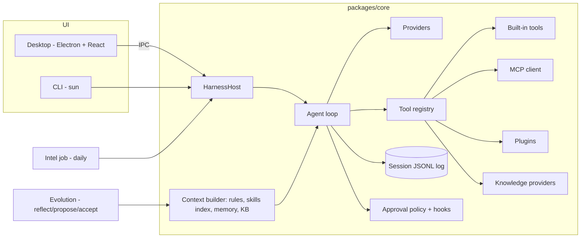

# sun-harness — Plan

Status legend: `[ ]` todo, `[~]` in progress, `[x]` done.

## Method

1. Derive the minimum harness from first principles (see `specs/000-vision.md`): model, context, tools, loop, log, policy.
2. Build that MVP with tests.
3. Loop: research what other harnesses do (intel) → pick the highest-value gap → spec it → build → test → document → repeat.

## Architecture

## Milestones

### M0 — Foundations `[x]`
- [x] `AGENTS.md` rules (English-only, spec-first, milestone definition of done)
- [x] `specs/000-vision.md`, this plan

### M1 — Core runtime MVP `[x]`
- [x] Append-only JSONL session log, `deriveMessages()`
- [x] Providers: OpenAI-compatible (DeepSeek, OpenAI, GLM, Qwen/DashScope, Gemini, Ollama) and Anthropic, streaming + tool calls
- [x] Error taxonomy: `quota`, `rate_limit`, `auth`, `network`, `context_length`, `other`
- [x] Agent loop with retries, abort, approval, max steps
- [x] Built-in tools: read/write/edit file, list, glob, grep, bash, web_fetch, todo
- [x] Approval modes `suggest | auto-edit | full-auto`, workspace path guard
- [x] Rules loader (AGENTS.md hierarchy, CLAUDE.md, `.sun/rules`, `.cursor/rules`), specs index
- [x] Durable pause/resume: quota pause, model switch, fallback chain, auto-resume probe
- [x] Context compaction
- [x] CLI `sun`
- [x] Tests (mock provider)

### M2 — Extensions, knowledge, modes `[x]`
- [x] Skills (`SKILL.md`, progressive disclosure, Claude-compatible locations)
- [x] MCP client (stdio + streamable HTTP)
- [x] Plugins (ESM, `api.registerTool/registerKnowledgeProvider/registerMode/on`)
- [x] Hooks (`preToolUse`, `postToolUse`, `sessionStart`, `stop`)
- [x] Knowledge: `KnowledgeProvider` seam, local markdown BM25 (CJK-aware), company HTTP provider (reserved)
- [x] Memory (`MEMORY.md`) + tools
- [x] Modes: coding, agent (Manus-like), assistant (Hermes-like); subagent `task` tool

### M3 — Desktop app `[x]`
- [x] Electron main hosts `HarnessHost`; secure preload bridge
- [x] Sessions sidebar, chat with streaming, tool cards, approval cards
- [x] Model/mode switch, paused banner with resume
- [x] Pages: Skills, MCP, Plugins, Knowledge, Memory, Evolution, Intel, Settings

### M4 — Intel + evolution `[x]`
- [x] Intel sources (GitHub releases + changelogs), dedupe, LLM analysis with principles, daily report
- [x] macOS launchd daily schedule + in-app catch-up scheduler
- [x] Evolution: reflect → proposals → accept into memory/skills/rules; intel adoption ideas → proposals

### M5 — Docs + verification `[x]`
- [x] Manual per milestone, teaching HTML per milestone with Mermaid
- [x] Full test + build + live model smoke + desktop screenshot

### Iteration 1 — fail-closed approvals `[x]`
- [x] Source: intel 2026-11-07 (Claude Code 2.1.317–2.1.319)
- [x] Spec `specs/008-approval-policy.md`; headless deny with reason; `denyInsteadOfPrompting`; hook `onFailure: "block"`
- [x] Tests, manual, teaching page `docs/teach/06-research-loop.html`

## Iteration backlog (research loop)

Filled from intel reports (`~/.sun/evolution/proposals`); each item becomes a spec before code.

| Candidate | Seen in | Part |
|---|---|---|
| Separate prompt budgets for global vs project rules | DeepSeek Harness 0.2.2 | Context |
| Compact with the old model before switching to a smaller-context model | DeepSeek Harness 0.2.2 | Loop |
| Background MCP tasks with eventual result delivery | Claude Code 2.1.319 | Tools |
| One gateway owns every session; surfaces attach as clients (web UI, bots) | Hermes Agent 0.23 | Architecture |
| Git worktree per session for parallel changes | DeepSeek Harness 0.2.2, Codex | Tools, policy |
| Embedding knowledge provider (plugin) | — | Context |
| Packaged, signed macOS app (`pnpm --filter @sun/desktop package`) | — | Desktop |
