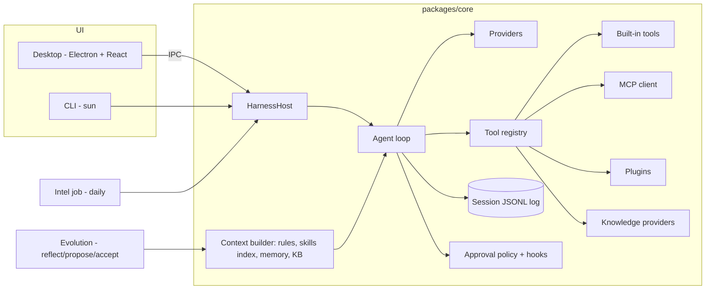

# sun-harness — Plan

Status legend: `[ ]` todo, `[~]` in progress, `[x]` done.

## Method

1. Derive the minimum harness from first principles (see `specs/000-vision.md`): model, context, tools, loop, log, policy.
2. Build that MVP with tests.
3. Loop: research what other harnesses do (intel) → pick the highest-value gap → spec it → build → test → document → repeat.

## Architecture

## Milestones

### M0 — Foundations `[x]`
- [x] `AGENTS.md` rules (English-only, spec-first, milestone definition of done)
- [x] `specs/000-vision.md`, this plan

### M1 — Core runtime MVP `[x]`
- [x] Append-only JSONL session log, `deriveMessages()`
- [x] Providers: OpenAI-compatible (DeepSeek, OpenAI, GLM, Qwen/DashScope, Gemini, Ollama) and Anthropic, streaming + tool calls
- [x] Error taxonomy: `quota`, `rate_limit`, `auth`, `network`, `context_length`, `other`
- [x] Agent loop with retries, abort, approval, max steps
- [x] Built-in tools: read/write/edit file, list, glob, grep, bash, web_fetch, todo
- [x] Approval modes `suggest | auto-edit | full-auto`, workspace path guard
- [x] Rules loader (AGENTS.md hierarchy, CLAUDE.md, `.sun/rules`, `.cursor/rules`), specs index
- [x] Durable pause/resume: quota pause, model switch, fallback chain, auto-resume probe
- [x] Context compaction
- [x] CLI `sun`
- [x] Tests (mock provider)

### M2 — Extensions, knowledge, modes `[x]`
- [x] Skills (`SKILL.md`, progressive disclosure, Claude-compatible locations)
- [x] MCP client (stdio + streamable HTTP)
- [x] Plugins (ESM, `api.registerTool/registerKnowledgeProvider/registerMode/on`)
- [x] Hooks (`preToolUse`, `postToolUse`, `sessionStart`, `stop`)
- [x] Knowledge: `KnowledgeProvider` seam, local markdown BM25 (CJK-aware), company HTTP provider (reserved)
- [x] Memory (`MEMORY.md`) + tools
- [x] Modes: coding, agent (Manus-like), assistant (Hermes-like); subagent `task` tool

### M3 — Desktop app `[x]`
- [x] Electron main hosts `HarnessHost`; secure preload bridge
- [x] Sessions sidebar, chat with streaming, tool cards, approval cards
- [x] Model/mode switch, paused banner with resume
- [x] Pages: Skills, MCP, Plugins, Knowledge, Memory, Evolution, Intel, Settings

### M4 — Intel + evolution `[x]`
- [x] Intel sources (GitHub releases + changelogs), dedupe, LLM analysis with principles, daily report
- [x] macOS launchd daily schedule + in-app catch-up scheduler
- [x] Evolution: reflect → proposals → accept into memory/skills/rules; intel adoption ideas → proposals

### M5 — Docs + verification `[x]`
- [x] Manual per milestone, teaching HTML per milestone with Mermaid
- [x] Full test + build + live model smoke + desktop screenshot

### Iteration 1 — fail-closed approvals `[x]`
- [x] Source: intel 2026-11-07 (Claude Code 2.1.317–2.1.319)
- [x] Spec `specs/008-approval-policy.md`; headless deny with reason; `denyInsteadOfPrompting`; hook `onFailure: "block"`
- [x] Tests, manual, teaching page `docs/teach/06-research-loop.html`

### Iterations 2–7 `[x]`
- [x] 2 — Context budgets: separate global/project rule budgets; model context windows; `%` compaction buffer; compact with the old model before downgrading (`specs/009`, teach 07)
- [x] 3 — Worktree sessions: isolated branch per session; status/diff; squash or merge; discard (`specs/010`, teach 08)
- [x] 4 — Background jobs: `bash` background, slow-MCP promotion, eventual delivery into the session (`specs/011`, teach 09)
- [x] 5 — Gateway: `sun serve` owns sessions; CLI/desktop/web attach; per-session approval; launchd service; headless schedules (`specs/012`, ADR 0005, teach 10)
- [x] 6 — Hybrid knowledge: BM25 + embeddings with rank fusion, content-addressed cache, BM25 fallback (`specs/013`, teach 11)
- [x] 7 — Packaged macOS app: self-contained bundle, offline packaging, Finder PATH, ad-hoc signing, icon (`specs/014`, teach 12)

### Iterations 8–11 `[x]`
- [x] 8 — Durable jobs: detached wrapper, on-disk record/exit status, re-attach and deliver after restart (`specs/015`, teach 13)
- [x] 9 — Approval race guard: prompt ids, stale-answer rejection, CLI pre-typed input guard, desktop arm delay, scoped approvers (`specs/016`, teach 14)
- [x] 10 — Remote gateway: TLS with self-signed pinned certificate, device tokens, `sun remote` (`specs/017`, ADR 0006, teach 15)
- [x] 11 — Chat bots: Telegram, DingTalk outgoing robot, webhook; allowlist, per-chat sessions, approvals in chat (`specs/018`, teach 16)
- [x] 11.1 — Feishu/Lark, WeChat Official Account, WeCom bots (`specs/018`, teach 16)

## Optimization plan (0.4.0) — coding success, Manus-like agent, personal assistant

Derived from a first-principles comparison with Codex / Claude Code (coding), Manus (sandboxed autonomous agent), and Hermes-like assistants. Every phase is measured; results and the decisions they forced are in the specs and teaching pages.

### Phase 0 — Measure `[x]`
- [x] 36-task coding eval suite (24 standard + 12 hard), each validated (fails untouched, passes with reference solution); hidden tests; `EVAL_BASE` diff checks
- [x] `sun eval validate | run | list | report | compare`, session telemetry, baselines for deepseek-chat and qwen-flash (`specs/019`, teach 17)

### Phase 1 — Coding success `[x]`
- [x] Tolerant `edit_file`, atomic `apply_patch`, read-before-overwrite + stale-read refusal (narrowed after evals), post-edit syntax diagnostics
- [x] Checkpoints + undo (CLI, chat, desktop, gateway); done gate (verify loop) with detected or configured commands
- [x] Capability gating, malformed tool-JSON repair, parallel read-only tools
- [x] LSP diagnostics after edits (typescript-language-server, pyright, gopls, rust-analyzer; fallbacks) — 0.4.1
- [x] Prompt-cache accounting (DeepSeek, OpenAI/DashScope, Anthropic) + Anthropic and DashScope cache markers; repository map + `repo_map`
- [x] Plan mode with plan approval; best-of-N in worktrees judged by project tests (`sun run --best-of`, `sun eval run --best-of`) (`specs/020`, teach 18)

### Phase 2 — Sandbox `[x]`
- [x] One exec interface for bash, jobs, verify, best-of-N judge, Python kernel; seatbelt (macOS), bubblewrap (Linux), Docker per session
- [x] Network on/off/allowlist (CONNECT proxy), hidden credentials and harness state, secret env scrubbing, optional auto-approve (`specs/021`, ADR 0007, teach 19)

### Phase 3 — Browser + takeover `[x]`
- [x] Raw CDP client; local Chrome, sandboxed Chromium (Xvfb, fluxbox, x11vnc, noVNC, socat; `docker/browser`), any CDP endpoint
- [x] Accessibility snapshots with refs; navigate/click/type/keys/scroll/back/screenshot/evaluate; persistent profiles, `sun browser login`
- [x] Live view (screencast) and takeover in the desktop; noVNC link (`specs/022`, ADR 0008, teach 20)

### Phase 4 — Research agent `[x]`
- [x] Search providers (Bing keyless, Tavily, Brave, Serper, Bocha, SearXNG, DuckDuckGo) with gating; readable Markdown + PDF `web_fetch` with paging
- [x] Persistent Python kernel; bounded parallel subagents; deliverables panel
- [x] Prompt-injection guard: untrusted wrapping, scanning, `context/taint`, policy escalation (`specs/023`, teach 21)

### Phase 5 — Assistant efficiency `[x]`
- [x] Layered memory (core + long-term), per-message recall, background extraction, `memory_search`
- [x] Model router (`background`, `auto` fast/strong); DingTalk via `dws` (read/write split); email/calendar MCP presets
- [x] Daily briefing (file, desktop, bot chats); file-watch and webhook triggers; voice input (DashScope ASR / Whisper) and read-aloud
- [x] Conversation efficiency metrics (`sun metrics`, desktop) (`specs/024`, teach 22)

## 0.5.0 — UX absorbed from competitors `[x]`
- [x] Custom slash commands (`.sun/commands`, `~/.sun/commands`, compat `.claude/commands`) in CLI, desktop, bots
- [x] @file / @folder / @image mentions with desktop completion
- [x] Inline diffs on edit tool results; cost tracking with a pricing table (`/cost`, session bar, status line)
- [x] Rewind (fork from any user message, optional file restore); export Markdown/HTML/JSONL, import JSONL
- [x] Desktop OS notifications, ⌘K command palette, full-text session search
- [x] `/compact`, CLI status line, `sun run --output stream-json`; image input (paste, drop, attach, `--image`) with vision gating
- [x] Stream watchdog for silent provider connections (`specs/025`, teach 23)

## 0.6.0 — Context usage and flow `[x]`
- [x] Per-conversation context usage: report (system sections, tools, messages by kind, attachments, images, provider usage, suggestions), desktop ring + panel + sidebar percent, `sun context`, `/context` (CLI, bots), HTML export
- [x] Steering messages mid-run; model-written titles; Esc / ↑ / ⌘N shortcuts; pin and archive (`specs/026`, teach 24)

## 0.7.0 — Automations and changed files `[x]`
- [x] Competitor analysis (ChatGPT Tasks, Cursor Automations, Manus, Zapier/n8n; Cursor, Codex, Claude Code, Cline, GitHub review) in `specs/027`
- [x] Natural-language schedules (EN + ZH), proposal flow on every surface, automations with history, catch-up, notifications; ⏲ Automations menu; `sun automations`; bot `/automations`
- [x] Changed files per turn and per session (A/M/D, diffs, full file, tree), per-file revert; CLI `/changes` `/diff` `/revert`, `sun changes`; bot summaries (teach 25)

## 0.8.0 — Desktop and web UI languages `[x]`

- [x] English + Simplified Chinese on every desktop/web page (`t()` / `tk()`, `locale-zh-CN.ts`)
- [x] `ui.language`: system / en / zh-CN; Settings + left-rail toggle; persists in `~/.sun/config.json`
- [x] Completeness test so later UI copy cannot ship in one language (`apps/desktop/test/i18n.test.ts`); `AGENTS.md` + `apps/desktop/AGENTS.md` (`specs/028`, ADR 0009, teach 26)

## 0.9.0 — Cursor-grade coding `[x]`

- [x] Competitor matrix (Cursor, Claude Code, Codex, Manus, Hermes, OpenCode, Cline, DeepSeek Harness): top 3 each, and the gaps still open (`specs/029`)
- [x] Local `codebase_search` (symbol + BM25) and `@codebase` / `@git` / `@rule`
- [x] `.cursorignore` / `.sunignore` on read, search, and mentions; glob rules attached after a matching file is in context
- [x] `/review` of the session diff (desktop, CLI, bots) — read-only `review/report` (teach 27)

## 0.10.0 — Manus and personal assistants `[x]`

- [x] Manus: `wide_research` (fresh subagent per item, `research/*.md`), `make_slides` (HTML deck + notes), Deliverables list (`specs/030`, teach 28)
- [x] Hermes / OpenClaw: capped `USER.md`, `remember_user`, daily notes, `/skill-name`, `session_search`

## 0.11.0 — Right workspace dock `[x]`

- [x] Cursor Agents Window column: Changes (+/−), Browser, Terminal (session command scrollback), Files (`listWorkspace`)
- [x] `DOCK_PANES` registry so another pane is one list entry (`specs/031`, teach 29)

## Iteration backlog (research loop)

Filled from intel reports (`~/.sun/evolution/proposals`); each item becomes a spec before code.

| Candidate | Seen in | Part |
|---|---|---|
| Locked, honest config writes (file lock, non-zero exit on failed writes) | Claude Code 2.1.317–318 | Log |
| Negative capability cache for MCP servers that fail fast | Claude Code 2.1.318 | Tools |
| Credential / key expiry surfaced in status | Claude Code 2.1.318 | Model |
| DingTalk Stream / Feishu long-connection modes (no public URL); Slack native adapter | Hermes Agent | Architecture |
| Desktop attaches to remote gateways (pinned), device management UI | — | Desktop |
| Developer ID signing + notarization; auto-update | — | Desktop |
| Learned router (from metrics) instead of keyword heuristics | — | Model |
| Browser: multi-tab, file upload/download, Playwright via connectOverCDP | Manus | Tools |
| DingTalk event stream (`dws event`) as a trigger kind | — | Architecture |

## Settings and competitor adoption — complete

- [x] Research and design pack: project/code map, official sources, 29 screenshot dispositions, 15 dependency-ordered task cards, contracts and failure cases (`docs/plans/settings-competitors/README.md`).
- [x] Planning harness: coverage/dependency/evidence checker, adversarial checker tests, normal test-suite integration; spec 032 and ADR 0010.
- [x] T01: offline compatibility fixtures and baseline evidence.
- [x] T02: revisioned settings, field validation, redaction, audit, recovery and CLI/desktop/web migration.
- [x] T03: versioned capability discovery, desktop-only adapter routes and extension revocation.
- [x] T04: searchable bilingual settings navigation, deep links and section drafts.
- [x] Post-T04 checkpoint measured: DeepSeek passed 8/9. The shortfall is retained as an interim result.
- [x] T05: persisted personal controls, separate profile and instructions, notification and voice readiness, native Mini stop, and session usage estimates.
- [x] T06: inert and redacted exports, staged portable import, archive restore, bounded inventory, and recoverable trash operations across desktop, web, and CLI transfer.
- [x] T07: digest-reviewed hooks, bounded sandbox execution, bilingual review and fixture controls, and plugin manifest inspection with immediate revocation and audited drain.
- [x] T08: authenticated gateway identity, active device revocation, request receipts, browser token exchange, desktop connection selection, local preference separation, and reconnect recovery.
- [x] T09: durable structured review, optional completion gate, read-only Git inspection, guarded worktree lifecycle, cleanup preview, and reviewed one-time setup.
- [x] T10: browser origin review, exclusive profile and tab control, single-use upload approvals, and bounded authenticated download staging.
- [x] T11: opt-in macOS Appshots, private preview and redaction, and digest-verified attachment replay. The signed macOS fixture passed capture, cancel, and send.
- [x] T12: scoped macOS Accessibility observations and actions, one active lease, durable receipts, and emergency stop. Signed native acceptance passed.
- [x] T13: macOS Keychain-backed website passwords, origin-bound private fill, and isolation from agent browser profiles and gateways.
- [x] T14: reviewed shell jobs on verified execution targets, durable start and cancellation recovery, and isolated Local Docker jobs.
- [x] T15: cross-surface and signed native acceptance, plus nine first-attempt passes on the final live handoff (`docs/plans/settings-competitors/evidence/T15.json`).

Task states and detailed dependencies: `docs/plans/settings-competitors/manifest.json`. Family-account services and public hosted cloud remain deferred; see the complete screenshot inventory.

## Full product verification — done

- [x] Plan the audit across all numbered specs, command and renderer surfaces, and integrations.
- [x] Run the feature matrix, reproduce defects, and verify repairs across affected surfaces (D01–D18).
- [x] Rebuild, rerun the complete matrix, and publish the final evidence ledger and report: 337 unit tests, 23 CLI process tests, and the renderer, Settings, Docker and package checks.
- [x] Positive Appshot, Computer Use and Keychain runs on the granted final signed package (`apps/desktop/release/full-product-d17`).

See the [report](plans/full-product-test/report.md), [feature ledger](plans/full-product-test/feature-ledger.md), [run log](plans/full-product-test/run-log.md), and [handoff](plans/full-product-test/handoff.md).
