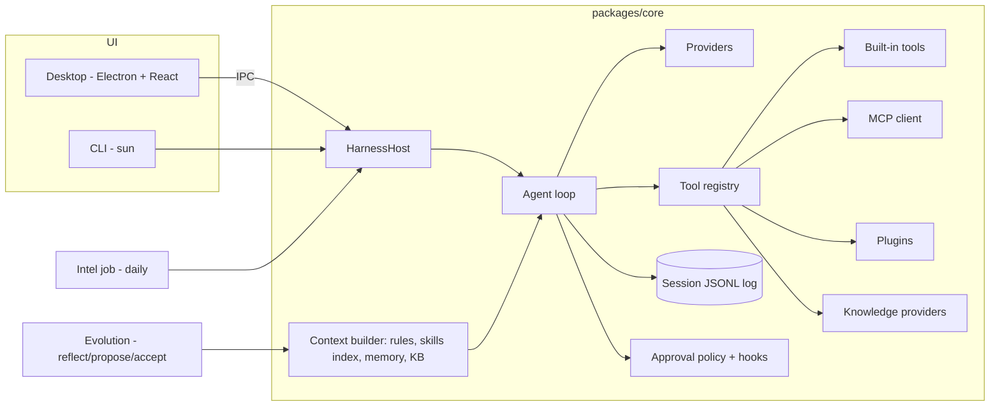

# sun-harness — Plan

Status legend: `[ ]` todo, `[~]` in progress, `[x]` done.

## Method

1. Derive the minimum harness from first principles (see `specs/000-vision.md`): model, context, tools, loop, log, policy.
2. Build that MVP with tests.
3. Loop: research what other harnesses do (intel) → pick the highest-value gap → spec it → build → test → document → repeat.

## Architecture

## Milestones

### M0 — Foundations `[x]`
- [x] `AGENTS.md` rules (English-only, spec-first, milestone definition of done)
- [x] `specs/000-vision.md`, this plan

### M1 — Core runtime MVP `[ ]`
- [ ] Append-only JSONL session log, `deriveMessages()`
- [ ] Providers: OpenAI-compatible (DeepSeek, OpenAI, GLM, Qwen/DashScope, Gemini, Ollama) and Anthropic, streaming + tool calls
- [ ] Error taxonomy: `quota`, `rate_limit`, `auth`, `network`, `context_length`, `other`
- [ ] Agent loop with retries, abort, approval, max steps
- [ ] Built-in tools: read/write/edit file, list, glob, grep, bash, web_fetch, todo
- [ ] Approval modes `suggest | auto-edit | full-auto`, workspace path guard
- [ ] Rules loader (AGENTS.md hierarchy, CLAUDE.md, `.sun/rules`, `.cursor/rules`), specs index
- [ ] Durable pause/resume: quota pause, model switch, fallback chain, auto-resume probe
- [ ] Context compaction
- [ ] CLI `sun`
- [ ] Tests (mock provider)

### M2 — Extensions, knowledge, modes `[ ]`
- [ ] Skills (`SKILL.md`, progressive disclosure, Claude-compatible locations)
- [ ] MCP client (stdio + streamable HTTP)
- [ ] Plugins (ESM, `api.registerTool/registerKnowledgeProvider/registerMode/on`)
- [ ] Hooks (`preToolUse`, `postToolUse`, `sessionStart`, `stop`)
- [ ] Knowledge: `KnowledgeProvider` seam, local markdown BM25 (CJK-aware), company HTTP provider (reserved)
- [ ] Memory (`MEMORY.md`) + tools
- [ ] Modes: coding, agent (Manus-like), assistant (Hermes-like); subagent `task` tool

### M3 — Desktop app `[ ]`
- [ ] Electron main hosts `HarnessHost`; secure preload bridge
- [ ] Sessions sidebar, chat with streaming, tool cards, approval cards
- [ ] Model/mode switch, paused banner with resume
- [ ] Pages: Skills, MCP, Plugins, Knowledge, Memory, Evolution, Intel, Settings

### M4 — Intel + evolution `[ ]`
- [ ] Intel sources (GitHub releases + changelogs), dedupe, LLM analysis with principles, daily report
- [ ] macOS launchd daily schedule + in-app catch-up scheduler
- [ ] Evolution: reflect → proposals → accept into memory/skills/rules; intel adoption ideas → proposals

### M5 — Docs + verification `[ ]`
- [ ] Manual per milestone, teaching HTML per milestone with Mermaid
- [ ] Full test + build + live model smoke + desktop screenshot

## Iteration backlog (research loop)

Filled from intel reports; each item becomes a spec before code.
