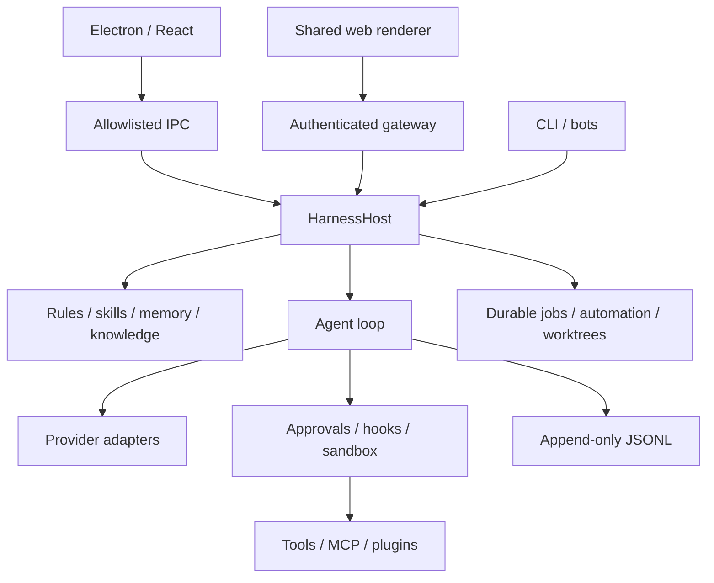

# Project understanding and research ledger

## What this project is

sun-harness is a local-first, provider-independent agent runtime with desktop, web, CLI and bot surfaces. Its three main workflows are coding, general research/action, and personal assistance. The fundamental architecture is model + context + tools + loop + durable log + policy. The settings project should make those parts understandable and controllable without growing another runtime.

## Evidence from source, not roadmap checkmarks

| Area | Inspected implementation anchor | Consequence for this plan |
|---|---|---|
| Runtime composition | `packages/core/src/host.ts`, `agent.ts`, `types.ts` | Extend host operations; do not put business logic in React |
| Persistence/replay | `log.ts`, `messages.ts`, specs 001/015/026 | Model input must remain reconstructable after restart |
| Configuration | `config.ts:loadConfig/saveConfig`, `host.ts:updateConfig` | Current merge/write has no revision conflict check or atomic replacement |
| Settings UI | `apps/desktop/src/renderer/src/pages.tsx:SettingsPage` | Existing large form with immediate per-field save; migrate incrementally |
| Transport | `gateway.ts:hostMethods`, shared `API_METHODS`, renderer `api.ts` | Any new API needs IPC, gateway and typed client parity |
| Extensions | `plugins.ts`, `mcp.ts`, `skills.ts`, `hooks.ts` | Reuse existing discovery and registry; avoid duplicate plugin system |
| Hooks | `hooks.ts:loadHooks/runHook` | Existing four lifecycle events; malformed files ignored; commands use bash and inherit environment. Add validation and trust before editing UX |
| Code review | `host.ts:reviewSession` | Existing read-only text review; caps diff at 8,000 chars/file and 24,000 total; request input not recorded in this path |
| Git/worktrees | `worktree.ts`, host worktree methods | Isolation, diff, merge and discard exist; management UI and conservative cleanup are gaps |
| Browser | `browser/browser.ts`, `browser/cdp.ts`, spec 022 | CDP and takeover exist; they are not whole-desktop computer control |
| Personalization | `memory.ts`, `assistant/memstore.ts`, `rules.ts` | Reuse existing profile/memory; separate user instructions from learned memory |
| UI translations | desktop AGENTS, `locale-zh-CN.ts`, `test/i18n.test.ts` | English and Simplified Chinese ship together |
| Evaluation | `eval.ts`, `evals/coding`, spec 019 | Existing mock/unit tests and coding tasks can support bounded-agent trials |

The current roadmap marks releases through 0.11 complete. This is an inventory, not a fresh acceptance audit of all releases. Baseline run: `pnpm test` passed 27 files, 195 tests, with 1 skipped; `pnpm build` passed. Production network/native flows were not exercised.

## Official-source ledger

All sources retrieved on 2026-11-07. Summaries below are deliberately narrow. Product availability depends on platform/account and may change. Screenshots establish visible labels only, not their internal implementation.

| ID | Primary source | Established fact | Confidence / use |
|---|---|---|---|
| O1 | [Desktop settings](https://learn.chatgpt.com/docs/app/settings) | Settings cover personal preferences, browser permissions, memories and archives | Verified; information architecture inspiration |
| O2 | [Appshots](https://learn.chatgpt.com/docs/appshots) | Frontmost-window image and available text become a chat attachment | Verified; context capture is separate from control |
| O3 | [Computer use](https://learn.chatgpt.com/docs/computer-use) | Native app control has setup and app permission requirements | Verified; native adapter and capability gating |
| O4 | [Remote connections](https://learn.chatgpt.com/docs/remote-connections) | Tasks can execute on a connected host; availability depends on that host | Verified; existing remote gateway is the closest sun equivalent |
| O5 | [Computers and apps](https://learn.chatgpt.com/docs/dots/computers-and-apps) | Cloud and personal computers are separate; saved-login reuse requires confirmation | Verified adjacent product context; not proof of every screenshot panel |
| O6 | [Developer commands](https://learn.chatgpt.com/docs/developer-commands) | Hook inspection/trust and managed worktree operations are exposed | Verified; do not copy undocumented event schemas |
| C1 | [Claude settings](https://code.claude.com/docs/en/settings) | Explicit scopes and precedence make configuration explainable | Verified; borrow provenance, not incompatible config files |
| C2 | [Claude hooks](https://code.claude.com/docs/en/hooks) | Lifecycle handlers provide deterministic workflow control | Verified; retain sun's event names and existing contracts |
| C3 | [Cursor Bugbot](https://cursor.com/docs/bugbot) | Diff-oriented reviews support review rules and structured findings | Verified; local read-only findings first, external posting out of scope |
| C4 | [Manus Browser Operator](https://www.manus.im/uk/blog/manus-browser-operator) | Authorized local-browser operation offers observation and takeover | Verified; adopt session ownership and intervention, not marketing guarantees |

The initial Manus documentation URL could not be fetched; the official product article above was opened instead. No current factual claims about Hermes/OpenCode/Cline capabilities are required for this release: the repository's earlier comparisons are historical context. Re-research them before selecting additional features.

## Priorities derived from actual gaps

| Candidate | Value | Cost/risk | Decision |
|---|---|---|---|
| Revisioned config, validation, provenance | Prevent lost updates across all surfaces | Medium / migration | P0, T02 |
| Capability-aware searchable settings | Makes existing features usable; honest unavailable states | Medium | P0, T03–T04 |
| Hook inspection and trust | Deterministic checks for weaker agents | Medium / executes code | P1, T07 |
| Review evidence and structured findings | Verifiable coding completion | Medium | P1, T09 |
| Worktree lifecycle safeguards | Protects concurrent coding work | Medium | P1, T09 |
| Browser ownership/site grants | More reliable authenticated tasks | Medium/high | P1, T10 |
| Appshots | Fast explicit cross-app context | Medium / native permissions | P2, T11 |
| Full computer control | Extends tasks beyond browser | High / native helper | P2, T12 after capability spike |
| Password broker | Enables private sign-in without model secrets | High / OS-specific | P3, T13 |
| Hosted cloud and account services | Weak fit with personal local harness | Very high | Self-hosted adapter T14; commercial hosting deferred |
| Mini/pet overlay | Optional convenience; low core-task value | Medium | P3, T05 limited Mini; animated pet asset system deferred |

## Complete screenshot disposition

The following inventory is normative for coverage; adaptation is a sun product decision, not a claim of source-product equivalence.

| ID | Screenshot label | Group | Decision | Delivery | Scope |
|---|---|---|---|---|---|
| S01 | General | Personal | adapt | T05 | Default model/mode, language and startup preferences; preserve existing configuration. |
| S02 | Notifications | Personal | adapt | T05 | Existing OS notifications gain event toggles, quiet hours and permission status. |
| S03 | Import | Personal | adapt | T06 | Existing JSONL import gains validation, dry-run summary and attachment-aware bundle import. |
| S04 | Profile | Personal | adapt | T05 | Local USER.md profile; no public identity or social profile service. |
| S05 | Appearance | Personal | adapt | T05 | System/light/dark theme, text size and reduced motion. |
| S06 | Account | Personal | adapt | T02 | Provider credential readiness and endpoint identity; no sun hosted account. |
| S07 | Archived chats | Personal | adapt | T06 | Reuse flags, search and unarchive; archive is not deletion. |
| S08 | Parental controls | Personal | defer | Deferred | Requires family identity, guardian consent and service operations; outside local single-owner scope. |
| S09 | Trusted contact | Personal | defer | Deferred | Requires account linkage and supported contact workflows; do not simulate by collecting a phone number. |
| S10 | Voice | Personal | adapt | T05 | Existing transcription/read-aloud controls with push-to-record and provider readiness. |
| S11 | Storage | Personal | new | T06 | Usage by resource, retention preview, resumable deletion and orphan detection. |
| S12 | Configuration | Personal | adapt | T02 | Validated transactional edits, effective values and source provenance. |
| S13 | Personalization | Personal | adapt | T05 | Rules, profile and memory controls with origins, limits and explicit edits. |
| S14 | Mini & Pets | Personal | adapt | T05 | Optional Mini status overlay; animated/custom pets deferred until asset/runtime spec exists. |
| S15 | Keyboard shortcuts | Personal | new | T05 | Discoverable remappable app shortcuts, conflicts, reset; global capture shortcut in T11. |
| S16 | Usage & billing | Personal | adapt | T05 | Existing usage and estimated cost; unknown prices remain unknown; no fabricated provider invoices. |
| S17 | Data controls | Personal | new | T06 | Export, retention and deletion; describe provider-bound data, do not promise provider-side deletion. |
| S18 | Plugins | Integrations | adapt | T07 | Existing local plugins/MCP gain readiness, trust, granted actions and failure diagnostics. |
| S19 | Passwords | Integrations | new | T13 | OS-backed credential references and private sign-in; no plaintext password model tool. |
| S20 | Computer use | Integrations | new | T12 | Capability-gated native adapter, per-app grants, ownership, visible stop and takeover. |
| S21 | Appshots | Integrations | new | T11 | Explicit frontmost-window capture, preview, redact, attach and durable replay. |
| S22 | Browser | Integrations | adapt | T10 | Profiles, tab ownership, origin/action permissions, download/upload and takeover. |
| S23 | Cloud computer | Integrations | adapt | T14 | Bring-your-own execution target; local Docker labeled local, never marketed as hosted cloud. |
| S24 | Hooks | Coding | adapt | T07 | Existing lifecycle events; list source, validate, trust by digest, test fixtures and execution history. |
| S25 | Connections | Coding | adapt | T08 | Existing pinned TLS gateway gains desktop connect, trust and device revoke controls. |
| S26 | Codex Cloud | Coding | adapt | T14 | Name sun counterpart Remote jobs; no implied access to OpenAI subscription backend. |
| S27 | Code Review | Coding | adapt | T09 | Logged review input, structured findings, review rules and stale-diff detection. |
| S28 | Git | Coding | adapt | T09 | Repository status/base selection, diff and explicit actions through host. |
| S29 | Worktrees | Coding | adapt | T09 | Existing worktree engine; inventory, ownership, setup trust, dirty/active cleanup guards. |
